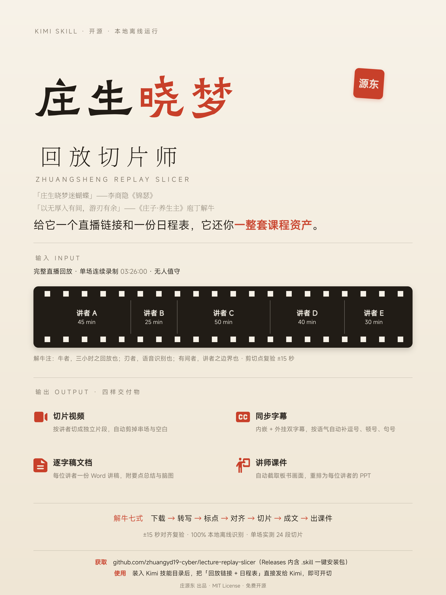

# Lecture Replay Slicer（录像切片师）

**Part of the "Zhuangsheng Jieniu" (庄生解牛) series · by Dongsheng (Zhuang Yuandong)**



> **Give it a video (link or local file) and a schedule — it gives you back a complete course asset pack:** one video clip per speaker + aligned subtitles + full transcript + summary + mind map + rebuilt PPT.

The name comes from *Zhuangzi · The Secret of Caring for Life* (庖丁解牛 / Pao Ding carves an ox): the master butcher never hacks at the ox — he follows its natural seams, and his blade stays sharp for nineteen years. **Here, the "ox" is hours of lecture replay; the "blade" is speech recognition; the "seams" are speaker boundaries.** We carve long recordings along their natural seams so that great minds' knowledge can be understood faster and absorbed better.

An AI-agent Skill that works with **Kimi, Codex, Claude Code, and Workbuddy**. Everything runs **100% locally and offline** — your recordings never leave your machine.

> 🗺️ See [ROADMAP.md](ROADMAP.md) for the path to SOTA: speaker diarization → FireRedASR/Qwen3-ASR engines → a public benchmark.

## What you get

Input:

- A replay link (Xiaoetong-style H5 platforms, Bilibili, YouTube) or a local video file
- Optionally a schedule (image / PDF / text) to derive speaker boundaries

Output:

```
cut/           one clip per speaker (embedded subtitle track + matching external .srt)
docs/          transcript Word docs with 3–5 sentence summaries
docs/mindmap/  mind maps (Mermaid)
ppt/           rebuilt, editable PPT decks from the lecture visuals
```

## Why not just whisper + ffmpeg?

Long-video transcription has invisible landmines; this skill turns every lesson we learned the hard way into a built-in defense:

- **Whisper timeline drift**: a naive 10-minute chunk can lag the audio by up to 40 s. We enforce 30-second windowed transcription, plus a closed loop of *sampled alignment checks → targeted re-transcription of drifted ranges only*.
- **Hallucination garbage**: applause/music/silence gets "recognized" as fixed signature phrases. Built-in filters.
- **Misalignment is hard to notice**: `align_check.py` re-listens every 5 minutes and prints per-segment offsets.
- **Schedule time ≠ video time**: schedules are wall-clock; recordings have offsets. A full anchor-alignment method is documented.
- **ffmpeg subtitle-track pitfalls**, **lossless-cut keyframe offsets**, **English word gluing**… 11 field-tested lessons in `references/pitfalls.md`.

## Adaptive by design

Before touching any video, run `scripts/detect_env.py`: it probes the OS / chip / RAM / GPU and automatically picks the right ASR engine and model size — from Apple Silicon full-power (`mlx-whisper large-v3`) down to a CPU-only `base int8` fallback. Decision table in `references/model-selection.md`. Same skill, optimal on every machine.

## Install — one sentence, zero clicks

No manual download needed. Just tell your AI agent (Kimi / Codex / Claude / Workbuddy):

> **Install this skill for me: https://github.com/zhuangyd19-cyber/lecture-replay-slicer**

The agent clones the repo into its skills directory and verifies it — done. Then say "庄生解牛" and it starts working.

<details>
<summary>Prefer manual install?</summary>

Download `lecture-replay-slicer.skill` from [Releases](https://github.com/zhuangyd19-cyber/lecture-replay-slicer/releases), or clone this repo into your agent's skills directory: `~/.codex/skills/`, `~/.claude/skills/`, `~/.workbuddy/skills/`, or Kimi's managed skills directory.
</details>

## Install (legacy notes)

1. Download `lecture-replay-slicer.skill` from [Releases](https://github.com/zhuangyd19-cyber/lecture-replay-slicer/releases), or copy this repo into your agent's skills directory:
   - Kimi: the managed skills directory
   - Codex: `~/.codex/skills/`
   - Claude Code: `~/.claude/skills/`
   - Workbuddy: `~/.workbuddy/skills/`
2. Dependencies: Python 3.9+, ffmpeg, yt-dlp, mlx-whisper (Apple Silicon) or faster-whisper (CUDA/CPU). Models auto-download on first run (set `HF_ENDPOINT=https://hf-mirror.com` for mirror acceleration).

## Usage — just talk to your agent

- **By intent**: "Download this replay", "Slice it by the schedule, one clip per speaker", "Add subtitles", "The subtitles don't match the audio", "Make a transcript / summary / mind map / PPT"
- **By brand**: say "庄生解牛", "庖丁解牛", or "carve this video like Pao Ding" — same skill, summoned by name

## Compliance

Download and process **only content you are authorized to use** (your own institution's replays, licensed courses, openly shared talks). Respect copyright and platform terms.

## License

MIT
